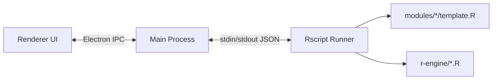

# EasyR

EasyR adalah aplikasi desktop statistik berbasis Electron + R yang dirancang untuk workflow analisis modern, reproducible, dan mudah dipakai.

## Fitur Utama

- 34 modul statistik siap pakai, termasuk Item Response Theory (IRT), Differential Item Functioning (DIF), dan Wright Map.
- Schema-Driven UI: antarmuka modul dibangkitkan dari `schema.json`, sehingga ekspansi modul konsisten dan cepat.
- Live R Syntax: script R terbentuk secara transparan dari parameter GUI untuk kemudahan audit dan pembelajaran.
- Universal CRAN Wrapper: eksekusi fungsi CRAN lintas paket melalui protokol yang seragam.
- R Console terintegrasi untuk eksplorasi dan debugging cepat.
- Format proyek `.ostat` untuk menyimpan dan melanjutkan sesi analisis.
- Sample Datasets bawaan untuk onboarding, demo, dan pengujian.
- R Setup Wizard untuk memvalidasi instalasi R lokal dan jalur executable.

## Arsitektur Singkat

EasyR memakai IPC Electron untuk komunikasi proses renderer-main, lalu menyalurkan request ke `Rscript` dengan protokol JSON.



## Prasyarat

- Node.js LTS (direkomendasikan versi aktif terbaru).
- npm.
- R lokal versi `>= 4.3` tersedia di mesin.

## Menjalankan Development Mode

```bash
npm install
npm run dev
```

## Build Aplikasi (Unpacked)

```bash
npm run dist:dir
```

Output akan tersedia di folder `release/` sebagai paket unpacked untuk pengujian lokal.

## Build Installer

```bash
npm run dist
```

Output installer Windows (`EasyR Setup *.exe`) akan dihasilkan di folder `release/`.

## Struktur Inti Repository

- `src/`: antarmuka React dan state management.
- `electron/`: main process, preload, dan bridge IPC.
- `modules/`: katalog modul statistik (`schema.json` + `template.R`).
- `r-engine/`: runner, formatter, dan helper eksekusi R.
- `tests/`: verifikasi smoke test dan validasi modul.

## Lisensi

Proyek ini dirilis di bawah GNU General Public License v3.0 (GPL-3.0). Lihat file `LICENSE`.
